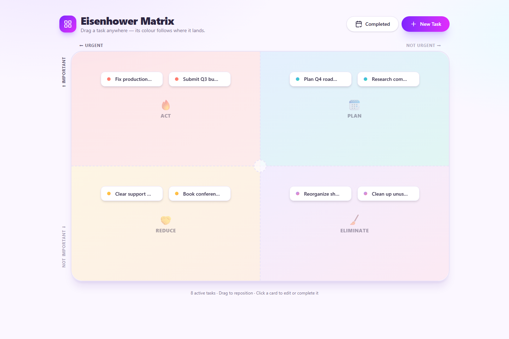

# 🗂️ Eisenhower Matrix — Task Planner

A colorful, playful single-page task planner built around the Eisenhower
(Urgent/Important) matrix. Drag tasks between the four quadrants to reprioritise
them, hover a card to read its description, and manage everything from one page.




## ✨ Features

- **One big board** — a single pane split into four colour-coded regions
  (Do First / Schedule / Delegate / Eliminate).
- **Free positioning** — drag a task *anywhere* on the board. Its colour and its
  *Important* / *Urgent* flags follow wherever it lands, updating live as you drag.
- **Never on the lines** — on release a card snaps fully inside whichever quadrant
  its centre is in, with a small gutter so it never straddles the dividing lines.
- **Sleek tiles** — each card shows just the task name (clipped if long); a colour
  dot reflects the quadrant it's in.
- **Click to open** — clicking a tile opens a detail view with an **Edit** mode for
  the name, description and due date, plus an option to complete it.
- **Completion history** — completed tasks leave the matrix but stay in SQLite
  with their completion date. View them beside **New Task** and filter the list
  with buttons for all time, 7 days, 14 days, or one month. Click a completed
  task to see its full description and due date, and reactivate it back to its
  previous matrix position.
- **Quick completion cue** — the coloured dot on a task becomes a matching
  coloured check control on hover; click it to confirm and complete the task
  without opening the detail view.
- **Hover to read** — the full name, optional **due date** and description appear as
  a floating tooltip, without nudging the card out of place.
- **Optional due dates** — set one when creating or editing; shown on hover and in
  the detail view.
- **Create menu** — a friendly dialog with a live "where will it land?" preview.
- **Confirm before it counts** — completing or deleting a task (from a card or
  the detail view) always shows a confirmation dialog first.
- **SQLite persistence** — tasks (name, description, important, urgent, x, y) are
  stored in a local SQLite database; position is the source of truth for the flags.

## 🧱 Tech stack

| Layer     | Choice                                                        |
| --------- | ------------------------------------------------------------ |
| Frontend  | React + TypeScript + Vite                                    |
| Styling   | Tailwind CSS v4 + shadcn-style components (Radix primitives) |
| Icons     | lucide-react                                                 |
| Backend   | Express                                                      |
| Database  | SQLite via Node's built-in `node:sqlite` (no native build!)  |

## 🚀 Getting started

Requires **Node.js 22.5+** (for the built-in `node:sqlite` module — you have v24).

```bash
npm install
npm run dev
```

- Frontend → http://localhost:5173
- API      → http://localhost:3001 (proxied under `/api`)

The `dev` script runs both the API and the Vite dev server together. On first run
the database is seeded with a few example tasks.

### Production build

```bash
npm run build     # type-check + bundle the frontend into dist/
npm start         # run the API server
```

## 🗃️ Data model

```
tasks(
  id          INTEGER PRIMARY KEY,
  name        TEXT,
  description TEXT,
  important   INTEGER (0/1),   -- derived from y (top half = important)
  urgent      INTEGER (0/1),   -- derived from x (left half = urgent)
  x           REAL (0..1),     -- centre position across the board
  y           REAL (0..1),     -- centre position down the board
  completed   INTEGER (0/1),
  completed_at TEXT,
  created_at  TEXT
)
```

Position is the source of truth; the server recomputes the two booleans from
`x` / `y` on every write. The quadrant is:

| Important | Urgent | Quadrant   |
| --------- | ------ | ---------- |
| ✅        | ✅     | Do First   |
| ✅        | ❌     | Schedule   |
| ❌        | ✅     | Delegate   |
| ❌        | ❌     | Eliminate  |

## 🔌 API

| Method   | Route             | Purpose                    |
| -------- | ----------------- | -------------------------- |
| `GET`    | `/api/tasks`      | List all tasks             |
| `POST`   | `/api/tasks`      | Create a task              |
| `PATCH`  | `/api/tasks/:id`  | Update fields / move task  |
| `DELETE` | `/api/tasks/:id`  | Delete a task              |

The SQLite file lives at `server/tasks.db` and is git-ignored.
